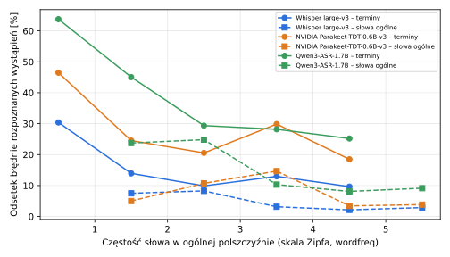

# Benchmarking Off-the-Shelf ASR Systems on Polish Radiology Dictation: Terminology, Numbers, and Clinically Critical Errors

Konrad Strojny

**Keywords:** automatic speech recognition; Polish; radiology; medical dictation; terminology; benchmark; word error rate

## Abstract

Ready-to-use automatic speech recognition (ASR) systems are increasingly considered for dictating radiology reports, yet their behaviour on Polish clinical speech is poorly characterised. This work benchmarks off-the-shelf systems on 939 natural-voice Polish research recordings (2.69 h, 14 speakers) of thyroid ultrasound and head-and-neck radiology. Besides the word error rate (WER, the fraction of reference words that are substituted, deleted, or inserted) and the character error rate (CER), the main focus is the correctness of **radiology terminology**: the term error rate (TER, the fraction of misrecognised occurrences of terms from a manually annotated lexicon of 309 forms) is compared with the same measure for general words. In classical ASR systems, radiology terms are recognised **3–6 times worse** than general words in the same recordings; large language model (LLM)-based transcribers narrow this gap. The best open model, Whisper large-v3, misrecognises 15.8% of term occurrences (95% CI 14.8–17.1) but only 3.1% of general words. More than half of its terminology errors are *near-misses* (e.g., "TIRADS" → "TIRAC", "miąższ" → "miosz"): the model hears the term but does not know its spelling. Abbreviations and foreign names are hardest (44–68% errors). The best cloud service, OpenAI gpt-4o-transcribe, reaches WER 5.96% (95% CI 5.4–6.5), outperforming Whisper large-v3 (8.03%); Google Gemini 3.5 Flash has the lowest TER (6.6%). ElevenLabs Scribe v2 spells out numbers (e.g., "2 mm" → "dwóch milimetrów"), which inflates its WER to 28.27%; after number-format normalisation its normalised WER is 5.22%. The higher error rate for terms also persists at equal word frequency, so it is not explained by word rarity alone.

## 1. Introduction

Radiologists increasingly dictate reports into speech recognition (ASR) systems. General-purpose models such as Whisper perform well on everyday speech. In radiology dictation they nonetheless make more errors: on terminology, numbers and units, abbreviations and proper names. Errors in an imaging report are not equivalent: some are cosmetic (punctuation, inflectional endings), while others change the clinical meaning and may go unnoticed by the physician:

- a swapped body side ("prawy" → "lewy", i.e. right → left),
- a wrong dimension ("45 mm" → "4 mm"),
- a lost negation ("bez zmian" → "zmian", i.e. without changes → changes),
- inserted words that were never spoken (so-called hallucinations).

**Research questions.**
1. How large is the recognition error (WER, CER) on Polish phrases from radiology reports for ready-made ASR solutions: open models run locally and commercial cloud services?
2. How correctly is radiology terminology written (anatomy, image description, diseases and procedures, abbreviations and foreign names) compared with general words in the same recordings? What kinds of errors occur: inflection, word segmentation, misspelling of a heard term, substitution with another word, deletion?

**Contributions.**
- A benchmark of 12 open configurations (10 open models, including language-model variants and a negative control) and 7 commercial cloud services on 939 Polish radiology recordings of natural voice.
- A term-level error analysis that separates radiology terms (309 forms in four classes) from general words via TER and GWER (general word error rate), and classifies errors into inflection, segmentation, near-miss, substitution, and deletion.
- Clinically critical error categories (numbers, negations, body side) and a proxy for hallucinations (insertions of three or more words).
- A number-format-normalised WER (WER-N) that separates recognition errors from number-formatting conventions.

## 2. Related Work

The open models evaluated here were introduced in prior work: Whisper [2], wav2vec 2.0 [3], and the multilingual MMS family [4]. Recent domain-specific and commercial transcribers are documented in their model cards and product documentation (Section 4.1). ASR benchmarking for clinical dictation has largely focused on English and on aggregate word error rates; this study targets Polish radiology dictation and analyses errors at the level of individual terms and clinically critical tokens (numbers, negations, body side).

## 3. Data

### 3.1 Research recordings

The study uses 939 natural-voice Polish radiology recordings (2.69 h, 14 speakers): short read phrases from thyroid ultrasound and head-and-neck reports, not spontaneous dictation of whole reports. The recordings come from a public research corpus (ADMEDVOICE; Kaggle `karmarci/polish-medical-multi-source-corpus`, DOI 10.34740/kaggle/ds/6698205, licence CC BY 4.0) [1]; only the natural human-voice variant is used.

### 3.2 Radiology subset

Of the eight topical categories of the corpus, the two radiology categories are retained:
- `02-001`: thyroid radiology, i.e. phrases from ultrasound (US) reports,
- `02-003`: head-and-neck radiology, including phrases from computed tomography (CT) and magnetic resonance imaging (MRI) reports.

The remaining categories (oncology, cardiology, resuscitation, recommendations, referrals) were removed because they are not diagnostic imaging.

**The test set comprises 939 natural recordings (2.69 h, 14 speakers, 246 texts)** from these two categories. Durations were computed from the WAV file headers (uncompressed audio). Phrases range from 2 to 46 words, 15.8 on average.

### 3.3 Database construction

The script `scripts/build_radiology_db.py` built an SQLite database (`recordings/radiology.sqlite`) and CSV files (`metadata.csv`, `phrases.csv`). For each recording the database stores:
- the reference transcription,
- the speaker and sex,
- the recording location and microphone,
- the audio parameters,
- quality scores from the corpus.

**Database schema** (`recordings/radiology.sqlite`; the CSV files have the same columns):

#### Table `recordings` (939 rows, the same as `metadata.csv`)

| Column | Description |
|---|---|
| `recording_id` | File name without `.wav` (primary key). |
| `path` | Path to the `.wav` relative to `recordings/`, e.g. `audio/natural/AMV010/….wav`. |
| `source` | `natural` (the set contains only natural voice). |
| `category_code`, `category` | `02-001` thyroid radiology (US) / `02-003` head-and-neck radiology. |
| `speaker_id` | `AMV…` speaker (human voice). |
| `speaker_sex`, `speaker_age` | `F`/`M` and age. |
| `rec_place` | `GU…` rooms at the Medical University of Gdańsk (GUMed), `PG…` studio, `UNKNV` online recording. |
| `mic_code`, `mic` | Microphone, e.g. `NTG2` = RODE NTG-2, `ONLN` = online. |
| `text_id` | Text identifier; foreign key to `phrases`. |
| `phrase_group` | Group of identical texts (see "Data issues" below). |
| `phrase` | **Reference transcription** (normalised spaces, Unicode NFC). |
| `duration_s`, `sample_rate`, `bit_depth`, `channels` | Read from the WAV header. |
| `mos_pred`, `grade`, `comments` | Quality scores and notes from the corpus metadata. |
| `recorded_at` | Date from the file name. |

#### Table `phrases` (246 rows, the same as `phrases.csv`)

Columns `text_id`, `phrase_group`, `category_code`, `phrase`, and `n_words`, plus the number of recordings of each text: `n_natural`.

#### Views

- `summary` contains the set counts by category.
- `speakers` contains, for each speaker: sex, age, microphones used, number of recordings, and minutes.

**Data issues found and fixed during database construction:**
- 61 recordings of speaker AMV102 carry category code `02-001` (thyroid) in the file name, but their texts concern the head and neck (e.g. facial-skull MRI, `text_id` 13289–13739). In the database they were assigned code `02-003`. Without this fix, head-and-neck would have counted 39 recordings instead of 100.
- 60 recordings use a non-standard separator (`_`) in the file name; the script handles this.
- The same text is sometimes uploaded under different `text_id`, because the authors fixed spacing and inflection. The `phrase_group` column groups texts that are identical after lowercasing and stripping the trailing period: 246 `text_id` yield 215 groups.

### 3.4 Repetitions

- **There are no identical files.** This was checked with the MD5 cryptographic hash of the audio samples, ignoring the WAV header.
- **The same speaker reads the same text several times:** 129 cases, 258 recordings in total. Each text has 3.8 recordings on average (up to 13).

### 3.5 Data limitations

- The set is small (2.69 h) and dominated by thyroid US: 839 recordings versus 100 from the head and neck.
- The recordings are read phrases, not spontaneous dictation, so they lack the pauses, corrections, and commands typical of dictation.
- The transcriptions use written form (e.g. "14x12x45 mm", "3.7 ml"), so both reference and hypothesis must be normalised before computing metrics.
- Audio is not uniform: sampling from 16 to 48 kHz, 16- or 24-bit depth.

## 4. Methods

### 4.0 Study stages

The study has two stages:
1. **No-help (measured here).** Each system receives only the recording and the information that the language is Polish. No vocabulary prompts, keyword lists (keyword boosting), custom dictionaries, medical context, or post-recognition correction are used. This stage measures how a ready-made solution performs "out of the box" and serves as a baseline. The only exception is Google Gemini (a general LLM), which requires a textual instruction: it receives a neutral "transcribe verbatim" prompt, with no vocabulary and no mention of medicine.
2. **With support (future work).** The same systems with the support mechanisms they offer (a prompt or a term list from the lexicon, custom dictionaries of the cloud services) and with post-recognition spelling correction of terms. This stage is to be compared with stage 1.

All results in Section 5 come from stage 1.

### 4.1 Evaluated systems

The evaluated systems are ready-made solutions that a radiologist or hospital can deploy today without their own training.

**Open models run locally (offline):**
- Whisper medium, large-v3-turbo, and large-v3 [2];
- recent 2025–2026 models with declared Polish support: NVIDIA Canary-1B-v2 [5], NVIDIA Parakeet-TDT-0.6B-v3 [6], and Qwen3-ASR-1.7B [8];
- NVIDIA FastConformer PL [7];
- wav2vec2 XLSR-53 Polish [3, 9] and Meta MMS-1b-all [4], each without a language model (LM) and with a general Polish KenLM (n-gram LM) [20];
- Google MedASR [10], an English-only model used as a negative control.

**Commercial cloud services (online):**
- OpenAI whisper-1 and gpt-4o-transcribe [11],
- ElevenLabs Scribe v2 [12],
- Deepgram Nova-3 [13],
- AssemblyAI Universal-2 [14],
- Speechmatics (Polish) [15],
- Google Gemini 3.5 Flash (transcription through a general LLM) [16].

Polish support for the new models was checked in their Hugging Face model cards (2026-11-17). Systems that could not be evaluated are listed in Section 7.

### 4.2 Procedure

**Test set:** 939 natural recordings (2.69 h, 14 speakers) from `recordings/radiology.sqlite`. Audio is resampled to 16 kHz mono (soxr).

**Decoding (identical within a model family, without prompts or dictionaries):**
- Whisper: transformers, greedy decoding, `language="pl"`, `task="transcribe"`, batch 8, half precision (fp16) on the Mac GPU (MPS, Metal Performance Shaders) [2, 17].
- CTC models (wav2vec2, MMS): greedy. The "+ KenLM" variants use beam search (pyctcdecode) with a general Polish 5-gram language model from the `jonatasgrosman/wav2vec2-large-xlsr-53-polish` repository [9, 19, 20]. This language model dates from 2021 and does not contain e.g. the word "hipoechogenny".
- NVIDIA NeMo (FastConformer, Canary, Parakeet): the model's default decoder; Canary with `source_lang=target_lang="pl"`.
- Qwen3-ASR: the `qwen-asr` package, transformers backend, `language="Polish"`.
- Cloud services (`eval/asr_eval/cloud.py`): each recording is sent as a separate request as a 16 kHz mono WAV, `language=pl`, without a prompt or dictionary (stage 1); up to 8 requests in parallel. The exception is Google Gemini (the general multimodal LLM `gemini-3.5-flash`), which through the `generateContent` API receives a neutral "transcribe verbatim" instruction — without vocabulary and without medical context. Asynchronous services (Speechmatics, Soniox, AssemblyAI) are polled for the result, and files and jobs are removed from their servers after the transcription is read. The RTF of cloud services includes network and queueing time, so it is not comparable with local models.

**Text normalisation** (`eval/asr_eval/textnorm.py`, identical for reference and hypothesis):
- lowercasing, punctuation removed;
- dimensions separated ("14x12x45" → "14 x 12 x 45"), unit detached from the number ("50mm" → "50 mm");
- decimal comma preserved;
- technical model tokens removed (`</s>`, `<unk>`).

Numbers are **not** converted to words, because digits are expected in a radiology report.

**Metrics** (`eval/asr_eval/metrics.py`, jiwer [18]):
- **WER and CER** with a 95% confidence interval from bootstrapping over utterances (1,000 resamples).
- **WER-N:** WER after converting numbers to words (num2words [23]), "x" → "na", and units written as words to abbreviations. This separates recognition errors from number-formatting conventions.
- **Clinically critical categories:** the fraction of misrecognised reference tokens (substitution or deletion) in three groups:
  - numbers (tokens containing a digit),
  - negations ("nie", "bez", "brak", i.e. no / without / absent),
  - body side (right/left in all forms).
- **CCER** (clinically critical error rate): a single token-weighted (micro-averaged) rate over the three critical categories, `CCER = 100·(num_err + neg_err + side_err) / (num_n + neg_n + side_n)`, computed over the pooled 2,988 critical reference tokens (1,990 numbers, 399 negations, 599 body-side). Each reference token counts once; only substitutions and deletions count (insertions are not critical-category errors), consistent with the per-category rates. CCER summarises, in one figure, how often a model gets the clinically salient tokens right, and complements the per-category breakdown.
- **Insertions ≥3:** places where the model inserted at least three words that were not present (a proxy for hallucinations).
- **RTF** (real-time factor): processing time divided by audio duration (MacBook Pro M1 Pro, 16 GB RAM).

**Result data:**
- `results/<model>/hyp.jsonl`: raw transcriptions;
- `results/<model>/metrics.json`: aggregate metrics;
- `results/summary.csv`: comparison of all models;
- database `results/results.sqlite`, rebuilt with `eval/build_results_db.py`:
  - tables `runs`, `utterances` (per-recording result), and `errors` (log of all errors),
  - views by category, speaker, and microphone.

### 4.3 Radiology terminology recognition

**Term lexicon** (`eval/lexicon/radiology_terms.tsv`). The reference vocabulary of the test set after normalisation has 736 word types without digits, so it was annotated in full, manually, rather than by a frequency filter. The annotation was produced by the language model Claude Opus 5.5 (Anthropic) with rules recorded in the file header; it has not yet been verified by a radiologist. Each term form has a lemma and one of four classes:

| Class | Content | Forms | Lemmas | Occurrences in references |
|---|---|---|---|---|
| anatomy (`anatomy`) | organs and regions and their adjectives: tarczyca, płat, cieśń, miąższ, przygardłowy | 112 | 68 | 2,326 |
| image description (`descriptor`) | echogenicity, echostructure, vascularisation, lesion morphology, sequences and techniques | 114 | 59 | 2,142 |
| pathology and procedures (`pathology`) | zapalenie, guzek, limfadenopatia, biopsja, parotidektomia | 54 | 35 | 410 |
| abbreviations and foreign names (`acronym`) | TIRADS, USG, DWI, PACS, color Doppler, Hashimoto, Gadovist | 29 | 29 | 551 |
| **terms total** | | **309** | **191** | **5,429** |
| general words (comparison group) | remaining words without digits: prawidłowy, wielkość, zmiana, położona, prawy | 424 | 319 | 9,405 |

Numbers, units, and the dimension sign "x" belong to no group. Two misspelled forms in the reference ("wiekości" instead of "wielkości", 13 occurrences; "hiperechegennicznym") were excluded from both groups.

**Fate of each reference word** (`eval/terms.py`). On the jiwer alignment (after normalisation from Section 4.2), each reference-word occurrence receives one status, checked in this order:
1. *correct*: identical form;
2. *word segmentation*: the same letters, a different split (splitting "okołotarczycowo" → "około tarczycowo", or merging "płynowo lita" → "płynowolita", "ti rads" → "tirads");
3. *deletion*: the word has no counterpart in the hypothesis;
4. *inflection*: the same lemma, a different inflectional form ("przepływu" → "przepływów"). Lemmas of reference forms come from the lexicon, and those of hypothesis words from the simplemma lemmatiser [22];
5. *near-miss*: character edit distance (Levenshtein) ≤ max(1, round(0.3 · word length)); the exception is a change of a meaning-bearing prefix (nie-, hipo-, hiper-, izo-, normo-), e.g. "niejednorodny" → "jednorodne", which always counts as a substitution;
6. *substitution*: any other word.

**Metrics:**
- **TER** (term error rate): the fraction of term occurrences with a status other than *correct*;
- **TER-L** (lenient version): only *near-miss*, *substitution*, and *deletion* are counted. Inflection and word segmentation are not errors, because a physician usually does not need to correct their meaning, only their spelling;
- **GWER** (general word error rate): the error fraction computed the same way as TER, for general words. The ratio TER/GWER indicates how many times harder the terms are for a model;
- 95% CI from bootstrapping over utterances (1,000 resamples, seed 0), as for WER.

**Rarity versus terminology.** To separate the domain effect from the word-rarity effect, the error fraction was computed separately in bins of word frequency in general Polish (Zipf scale: log10 of occurrences per billion words, wordfreq 3.1.1 library [21, 24]).

## 5. Experiments and Results

### 5.1 Open models run locally

Values in percent; WER with 95% CI. The "Numbers", "Negations", and "Body side" columns give the fraction of misrecognised tokens in that category (n = 1,990 / 399 / 599 reference tokens); CCER pools the three into one token-weighted rate over their 2,988 reference tokens (Section 4.3).

| Model | WER [95% CI] | WER-N | CER | Numbers | Negations | Body side | CCER | Insertions ≥3 | RTF |
|---|---|---:|---:|---:|---:|---:|---:|---:|---:|
| Whisper large-v3 | 8.03 [7.43–8.73] | 7.61 | 2.17 | 2.8 | 2.8 | 2.5 | 2.71 | 2 | 0.139 |
| Whisper large-v3-turbo | 9.75 [9.1–10.44] | 9.21 | 2.57 | 2.8 | 1.5 | 2.8 | 2.61 | 3 | 0.082 |
| Whisper medium | 13.77 [12.94–14.64] | 13.12 | 3.94 | 4.1 | 2.5 | 3.8 | 3.85 | 6 | 0.071 |
| NVIDIA Parakeet-TDT-0.6B-v3 | 18.21 [17.2–19.2] | 15.03 | 6.29 | 20.8 | 1.8 | 5.3 | 15.13 | 3 | 0.097 |
| NVIDIA Canary-1B-v2 | 20.05 [18.95–21.34] | 14.04 | 8.66 | 25.6 | 1.5 | 5.0 | 18.27 | 8 | 0.295 |
| Qwen3-ASR-1.7B | 21.8 [20.9–22.76] | 18.35 | 7.37 | 7.7 | 10.3 | 13.7 | 9.27 | 3 | 0.151 |
| Meta MMS-1b-all (pol) + KenLM | 32.07 [30.88–33.35] | 25.72 | 12.47 | 81.8 | 1.8 | 6.8 | 56.09 | 13 | 0.101 |
| Meta MMS-1b-all (pol adapter, no LM) | 35.22 [33.87–36.48] | 27.46 | 13.17 | 57.3 | 6.3 | 11.0 | 41.23 | 36 | 0.088 |
| NVIDIA FastConformer PL (hybrid, P&C) | 50.7 [49.26–52.17] | 31.4 | 30.29 | 100.0 | 7.5 | 37.1 | 75.03 | 41 | 0.03 |
| wav2vec2 XLSR-53 Polish + KenLM | 52.8 [51.22–54.3] | 32.94 | 29.54 | 100.0 | 14.0 | 20.7 | 72.62 | 132 | 0.066 |
| wav2vec2 XLSR-53 Polish (no LM) | 58.31 [56.67–59.69] | 41.08 | 30.68 | 100.0 | 23.8 | 25.5 | 74.90 | 121 | 0.07 |
| Google MedASR | 99.65 [99.21–100.08] | 99.01 | 80.48 | 98.2 | 100.0 | 100.0 | 98.83 | 41 | 0.011 |

**Observations.**
- **Whisper large-v3 is the best open model** (WER 8.0%), also relative to the newer 2025–2026 models NVIDIA Canary-1B-v2, Parakeet-TDT-0.6B-v3, and Qwen3-ASR-1.7B.
- **CCER confirms the ranking but exposes clinically risky outliers.** Whisper large-v3 has the lowest CCER among open models (2.71%), close to its three category rates; Qwen3-ASR reaches a much higher CCER (9.27%) than its low number-error rate (7.7%) because of frequent negation (10.3%) and body-side (13.7%) errors.
- **The new NVIDIA models lose mainly on number formatting** (20–26% errors on dimensions). After normalising the format (WER-N 14–15%) they approach Whisper medium.
- **Qwen3-ASR handles numbers well but negations and body side poorly** (10–14% errors), i.e. the categories most dangerous clinically.
- **A general Polish language model improves CTC models:** wav2vec2 from 58.3 to 52.8% WER, MMS from 35.2 to 32.1%, and for MMS the number of long insertions drops from 36 to 13.
- **NVIDIA FastConformer PL confuses body side in 37% of cases** (e.g. "prawym" → "prawem").
- **Google MedASR** (English-only) yields WER ~100%, as expected for the negative control. It replaces Polish speech with English medical terms ("discharge", "protein"), illustrating the hallucination mechanism.

### 5.2 Cloud services

Columns as in Section 5.1. The RTF includes network and queueing time, so it is not comparable with local models (Section 4.2).

| Model | WER [95% CI] | WER-N | CER | Numbers | Negations | Body side | CCER | Insertions ≥3 | RTF |
|---|---|---:|---:|---:|---:|---:|---:|---:|---:|
| OpenAI gpt-4o-transcribe | 5.96 [5.4–6.52] | 4.47 | 2.03 | 1.9 | 2.0 | 2.7 | 2.07 | 1 | 0.021 |
| OpenAI whisper-1 | 9.93 [9.26–10.62] | 9.45 | 2.58 | 3.5 | 3.3 | 3.5 | 3.48 | 1 | 0.032 |
| AssemblyAI Universal-2 | 10.25 [9.54–10.96] | 9.71 | 2.77 | 3.5 | 2.8 | 3.8 | 3.48 | 1 | 0.265 |
| Google Gemini 3.5 Flash | 10.4 [9.75–11.09] | 4.18 | 4.03 | 3.0 | 1.0 | 3.0 | 2.74 | 8 | 0.076 |
| Deepgram Nova-3 | 15.06 [14.3–15.84] | 8.48 | 7.88 | 8.0 | 3.5 | 2.5 | 6.33 | 6 | 0.018 |
| Speechmatics (pl) | 19.41 [18.68–20.18] | 16.37 | 6.18 | 16.1 | 0.3 | 7.0 | 12.18 | 1 | 0.03 |
| ElevenLabs Scribe v2 | 28.27 [26.22–30.33] | 5.22 | 23.53 | 97.7 | 1.3 | 1.7 | 65.56 | 65 | 0.037 |

**Observations.**
- **OpenAI gpt-4o-transcribe is the best system overall** (WER 5.96%, CER 2.03%, WER-N 4.47%, the lowest number-error rate: 1.9%). It surpasses the best open model, Whisper large-v3 (8.03%), and all cloud competitors. As many as 54% of its utterances are transcribed without error (Whisper large-v3: 39.6%).
- **By CCER, gpt-4o-transcribe is the clinically safest (2.07%) and Gemini 3.5 Flash is close (2.74%)**, whereas ElevenLabs Scribe v2 has the highest CCER among cloud services (65.56%): its number verbalisation turns numbers into a critical-error source even though its TER is low.
- **Google Gemini 3.5 Flash writes terms best** (TER 6.6%, the lowest of all, versus 15.8% for Whisper large-v3) and has the best WER-N (4.18%) and the fewest negation errors (1.0%). Its raw WER (10.4%) is higher because the general LLM "smooths" the content (punctuation, word splitting, 8 longer insertions), which the WER metric counts as errors.
- **OpenAI whisper-1 (9.93%)** and AssemblyAI Universal-2 (10.25%) sit just behind Whisper large-v3, but ahead of Whisper medium (13.77%). AssemblyAI almost never inserts longer phrases (1 insertion).
- **ElevenLabs Scribe v2 spells out numbers**, which artificially inflates WER: "2 mm" → "dwóch milimetrów", "14x12x45 mm" → "czternaście na dwanaście na czterdzieści pięć milimetrów", "10.9 ml" → "dziesięć i dziewięć dziesiątych mililitra". This affects 97.7% of tokens with a digit and raises CER to 23.53%. After normalising the number format (WER-N) ElevenLabs reaches 5.22% — the third best result (after Gemini 4.18% and gpt-4o-transcribe 4.47%). At the same time it has the most long insertions (65 versus 1–6 for the others), suggesting "smoothing" of the content rather than verbatim transcription.
- **Speechmatics**, despite a declared medical model, does not stand out: WER 19.41%, worst on body side (7.0%) and on numbers (16.1%).
- **Deepgram Nova-3** is the fastest (RTF 0.018) and close to AssemblyAI in WER-N (8.48%).

### 5.3 Radiology terminology

The same transcriptions as in Sections 5.1 and 5.2, evaluated with the method of Section 4.3. Values in percent. The columns "Inflection" … "Deletion" give the fraction of all term occurrences (n = 5,429); their sum is TER.

| Model | TER [95% CI] | TER-L | GWER | TER/GWER | Inflection | Segmentation | Near-miss | Substitution | Deletion |
|---|---:|---:|---:|---:|---:|---:|---:|---:|---:|
| Whisper large-v3 | 15.8 [14.8–17.1] | 13.0 | 3.1 | 5.1 | 0.9 | 2.0 | 8.7 | 3.4 | 0.8 |
| Whisper large-v3-turbo | 19.5 [18.4–20.8] | 16.5 | 3.4 | 5.7 | 1.1 | 1.9 | 11.4 | 4.1 | 1.0 |
| Whisper medium | 27.0 [25.6–28.4] | 23.6 | 5.6 | 4.8 | 1.3 | 2.1 | 15.1 | 7.2 | 1.3 |
| NVIDIA Parakeet-TDT-0.6B-v3 | 28.9 [27.6–30.3] | 25.3 | 5.9 | 4.9 | 1.0 | 2.7 | 14.9 | 7.4 | 3.0 |
| NVIDIA Canary-1B-v2 | 30.1 [28.8–31.4] | 26.3 | 5.7 | 5.3 | 1.5 | 2.3 | 14.5 | 10.0 | 1.8 |
| Meta MMS-1b-all (pol) + KenLM | 30.3 [28.9–31.5] | 24.1 | 9.0 | 3.4 | 1.5 | 4.8 | 14.8 | 7.0 | 2.2 |
| Meta MMS-1b-all (no LM) | 39.3 [37.8–40.7] | 35.3 | 14.1 | 2.8 | 1.2 | 2.8 | 24.2 | 8.0 | 3.0 |
| Qwen3-ASR-1.7B | 39.3 [37.7–40.7] | 33.9 | 10.2 | 3.8 | 3.0 | 2.3 | 20.1 | 10.8 | 3.0 |
| wav2vec2 XLSR-53 Polish + KenLM | 46.0 [44.5–47.4] | 40.0 | 26.0 | 1.8 | 1.6 | 4.4 | 18.4 | 18.7 | 2.9 |
| NVIDIA FastConformer PL | 53.9 [52.3–55.3] | 49.2 | 23.2 | 2.3 | 1.7 | 3.0 | 22.4 | 20.7 | 6.1 |
| wav2vec2 XLSR-53 Polish (no LM) | 54.9 [53.3–56.3] | 49.7 | 31.9 | 1.7 | 1.6 | 3.7 | 22.9 | 22.4 | 4.4 |
| Google MedASR (negative control) | 97.6 [97.2–98.1] | 97.6 | 98.1 | 1.0 | 0.0 | 0.0 | 0.5 | 50.1 | 47.1 |

Cloud services (same columns):

| Model | TER [95% CI] | TER-L | GWER | TER/GWER | Inflection | Segmentation | Near-miss | Substitution | Deletion |
|---|---:|---:|---:|---:|---:|---:|---:|---:|---:|
| Google Gemini 3.5 Flash | 6.6 [5.8–7.4] | 4.8 | 4.0 | 1.6 | 1.3 | 0.4 | 2.8 | 1.6 | 0.5 |
| ElevenLabs Scribe v2 | 7.2 [6.4–8.1] | 5.7 | 10.1 | 0.7 | 0.6 | 0.9 | 3.7 | 1.6 | 0.4 |
| OpenAI gpt-4o-transcribe | 7.6 [6.8–8.5] | 4.5 | 2.9 | 2.6 | 1.4 | 1.7 | 1.8 | 2.2 | 0.5 |
| Deepgram Nova-3 | 16.6 [15.3–17.9] | 13.9 | 11.1 | 1.5 | 1.2 | 1.5 | 7.6 | 4.4 | 1.9 |
| OpenAI whisper-1 | 19.1 [17.9–20.3] | 15.5 | 3.7 | 5.2 | 1.3 | 2.3 | 9.8 | 4.7 | 0.9 |
| AssemblyAI Universal-2 | 19.3 [18.0–20.6] | 15.8 | 4.3 | 4.5 | 1.1 | 2.4 | 9.8 | 4.9 | 1.1 |
| Speechmatics (pl) | 29.2 [27.9–30.4] | 23.0 | 6.7 | 4.4 | 2.4 | 3.8 | 11.4 | 10.1 | 1.6 |

TER by term class (selected models; full table: `results/terms/by_class.csv`):

| Model | Anatomy | Image description | Pathology and procedures | Abbreviations and foreign names |
|---|---:|---:|---:|---:|
| Whisper large-v3 | 12.2 | 12.6 | 15.9 | 43.9 |
| Whisper large-v3-turbo | 13.5 | 17.4 | 15.1 | 56.8 |
| NVIDIA Parakeet-TDT-0.6B-v3 | 23.3 | 24.0 | 33.4 | 68.2 |
| NVIDIA Canary-1B-v2 | 27.7 | 23.7 | 33.4 | 62.4 |
| Qwen3-ASR-1.7B | 30.0 | 40.6 | 58.1 | 59.4 |

**Observations.**
- **Terms are 3.4–5.7 times harder than general words** for the seven classical models with GWER ≤ 10.2% (Whisper, NVIDIA Canary and Parakeet, Qwen3-ASR, MMS + KenLM). The TER/GWER ratio drops to 1.7–2.8 for models that also recognise ordinary Polish poorly (MMS without LM, wav2vec2, FastConformer), and to 1.0 in the negative control.
- **The exception is ElevenLabs Scribe v2: terms are easier for it than general words** (TER/GWER 0.7 — the only system below 1.0; TER 7.2%, the second best after Gemini, versus 15.8% for Whisper large-v3). A high GWER (10.1%) with a low TER suggests that ElevenLabs retains rare terms better (perhaps owing to number verbalisation and "smoothing") and errs rather on common words and conjunctions.
- **Near-miss dominates, not substitution with another word.** For Whisper large-v3, 8.7 of the 15.8 percentage points of TER are near-misses: the model recognises the sound of the term but does not know it. The most frequent: "TIRADS" → "TIRAC"/"TIRATS"/"TIRAS" (104 of 176 occurrences), "color" → "kolor" (34), "miąższ" → "miosz"/"miąż" (19), "guzki" → "głuski"/"guski" (15), "cieśń" → "cieść" (8). This suggests that a prompting dictionary or post-recognition spelling correction could remove much of the error without changing the acoustic model; this will be tested in stage 2 (Section 4.0).
- **Hyphenated compounds written together are split** ("okołotarczycowo" → "około tarczycowo", "gładkokonturowany" → "gładko konturowany"): 2–5% of term occurrences.
- **The hardest class is abbreviations and foreign names** (44–68% errors). TIRADS alone accounts for 18% of Whisper large-v3's terminology errors; after excluding the abbreviations TIRADS, EU, CD, and color, that model's TER drops from 15.8 to 12.8%.
- **Qwen3-ASR stands out for weakness on disease and procedure names** (58% errors: "limfadenopatii", "autoimmunologicznym", "parotidektomii") and on echogenicity adjectives ("hipoechogenny": 87% errors versus 20% for Whisper large-v3).
- **The domain effect is not reducible to word rarity.** Words absent from the general corpus (Zipf < 1, e.g. "hipoechogenna") are the hardest for all models (30% errors for Whisper large-v3). However, even at the same general frequency (Zipf 3–5), terms have 10–13% errors while general words have 2–3% (Whisper large-v3; figure above, data in `results/terms/by_zipf.csv`). Words such as "płat", "miąższ", or "cieśń" are known in general Polish, yet in the radiological context the models write them worse.
- The terms most often confused by the three best models (averaged, lemmas with ≥ 10 occurrences): gładkokonturowany (97%), PACS (95%), TIRADS (94%), torbielowaty (92%), dopplerowski (82%), okołotarczycowy (79%), normoechogeniczny (75%). Full list: `results/terms/by_lemma.csv`.

**Limitations of this analysis.**
- The lexicon was annotated by a language model, without verification by a radiologist; the boundary between a term and a general word is conventional (e.g. "zmiana", "prawidłowy" were treated as general).
- The corpus covers only two categories (thyroid US, head and neck), so the vocabulary is narrow, and individual terms (TIRADS: 176 occurrences) strongly affect the result.
- The near-miss threshold (30% of word length) is arbitrary; for short words it may classify a genuinely different word as a near-miss ("płat" → "płot").
- "color" → "kolor" is a Polonisation of spelling rather than a recognition error, and is nonetheless counted as an error.

## 6. Discussion

**Classical ASR versus LLM-based transcribers.** The results separate two families. Classical acoustic ASR systems (Whisper, NVIDIA Canary/Parakeet, wav2vec2, MMS, and the classical cloud engines) treat terminology as a hard out-of-vocabulary problem: the acoustic signal is recognised, but the term is written as a phonetically plausible near-miss (Section 5.3). This is why the TER/GWER ratio is high (3.4–5.7) for these systems, and why most of their terminology error is near-miss rather than substitution or deletion. LLM-based transcribers (OpenAI gpt-4o-transcribe, Google Gemini 3.5 Flash, and, in WER-N terms, ElevenLabs Scribe) bring lexical knowledge to spelling: they pick the correct written form of "TIRADS" or "hipoechogenny" far more often. gpt-4o-transcribe achieves the lowest WER (5.96%) and Gemini the lowest TER (6.6%) of all systems. The trade-off is a tendency to "smooth" the output — changes in punctuation and word segmentation and additional insertions — which a raw WER penalises but which a clinician may tolerate or even prefer. A number-format-normalised WER (WER-N) and the TER therefore give a more faithful picture of clinical usefulness than aggregate WER alone.

**Number verbalisation is a metric artefact, not a recognition failure.** ElevenLabs Scribe v2 renders numbers as words ("2 mm" → "dwóch milimetrów"), producing a raw WER of 28.27% that would wrongly suggest a poor system. Its WER-N of 5.22% places it among the best. Any benchmark of Polish (or other morphologically rich) radiology dictation should therefore report a number-normalised metric alongside raw WER, and should state explicitly which convention (digits versus words) the deployment context requires.

**What matters clinically is not aggregate WER.** The clinically critical categories diverge from the aggregate ranking. Qwen3-ASR is competitive on numbers (7.7% number errors) but has the worst negation- and body-side error rates among open models (10.3% and 13.7%), and FastConformer PL confuses body side in 37% of cases. A system chosen on aggregate WER may therefore still be the riskiest for a signed report. A deployment decision should weight numbers, negations, and body side explicitly, and a human-in-the-loop review should target exactly these tokens. We summarise the three categories in a single clinically critical error rate (CCER, Section 4.3): gpt-4o-transcribe leads (2.07%), Gemini 3.5 Flash follows (2.74%), and ElevenLabs Scribe v2 is the riskiest among cloud services (65.56%) because it spells numbers out.

**Near-miss dominance points to a cheap remedy.** Because most terminology errors in classical ASR are near-misses — the acoustic model heard the word but did not know its spelling — a lexicon-driven post-correction or a decoding-time term list could remove a large share of errors without retraining. An upper bound for this remedy is visible in the gap between TER (15.8%) and TER-L (13.0%) for Whisper large-v3, and in the concentration of errors on a small set of high-impact abbreviations (TIRADS, PACS, color Doppler). This is the object of stage 2.

## 7. Limitations

- **Data.** The test set is small (2.69 h), covers two categories dominated by thyroid ultrasound, and consists of read phrases rather than spontaneous dictation (Section 3.5). Results may not transfer to full, free-form reports or to other anatomical regions.
- **Lexicon.** The term annotation was produced by a language model and not verified by a radiologist; the term/general boundary is conventional (Section 5.3).
- **Metrics.** Near-miss classification uses an arbitrary edit-distance threshold; raw WER penalises benign formatting differences, which is why WER-N and TER are reported alongside it. The hallucination proxy (insertions ≥ 3) is coarse.
- **Local RTF** was measured on a single machine (MacBook Pro M1 Pro, 16 GB); cloud RTF includes network and queueing and is not directly comparable with local models.
- **Coverage of systems.** Several planned systems could not be evaluated at the time of writing and are not included: Cohere Transcribe 03-2026 and NVIDIA Nemotron 3.5 Transcribe (gated or requiring a rented GPU), Soniox (no account balance), Google Chirp (requires a Google Cloud project), and Azure AI Speech (no key). The dedicated Google transcription model `gemini-3.5-transcribe` enforces a limit of 100 requests per day on its first tier (AI Studio), which precludes a full run of 939 recordings in a single day; the general `gemini-3.5-flash` model was measured instead. These omissions may change the ranking once resolved.
- **Stage 1 only.** The study measures systems without support (no vocabulary prompts, custom dictionaries, or post-correction). The effect of such support (stage 2) is future work.

## 8. Conclusion

Ready-made ASR systems are close to usable for Polish radiology dictation, but aggregate WER hides the clinically relevant failures. On 939 natural-voice recordings, the best open model (Whisper large-v3) reaches WER 8.03% but misrecognises 15.8% of radiology terms, 3–6 times more than general words, with near-misses dominating. LLM-based transcribers narrow this gap: OpenAI gpt-4o-transcribe attains the best overall WER (5.96%) and Google Gemini 3.5 Flash the best terminology accuracy (TER 6.6%). Number formatting can inflate raw WER dramatically, so a number-normalised metric is essential; ElevenLabs Scribe v2 drops from a misleading 28.27% raw WER to 5.22% WER-N. Because errors concentrate in numbers, negations, body side, and a handful of abbreviations, both model selection and quality assurance should target these tokens rather than the aggregate score, and a lexicon-based post-correction is a promising, low-cost next step.

## Data and Code Availability

The **ADMEDVOICE** corpus is public (Kaggle `karmarci/polish-medical-multi-source-corpus`, DOI 10.34740/kaggle/ds/6698205, licence CC BY 4.0) [1]. The evaluation code, the term lexicon, and the per-model transcriptions and metrics are provided in the project repository (`halucination_research`, GitHub `kocasp/halucination_research`); the audio itself is not redistributed and is reconstructed from ADMEDVOICE with `scripts/build_radiology_db.py`. Reproducibility details (library versions, seeds, timing) are listed in Section 9.

## 9. Reproducibility

| Element | Version / source | Use |
|---|---|---|
| ADMEDVOICE | Kaggle, DOI 10.34740/kaggle/ds/6698205, CC BY 4.0 | data |
| Python | 3.15.2 (standard library: `csv`, `sqlite3`, `struct`, `hashlib`) | database construction, WAV header reading |
| SQLite | 3.43.2 | metadata database |
| NumPy | 2.5.5 (Python 3.12.16) | (volume-envelope analysis, not used in current results) |
| PyTorch | 2.15.0 (MPS) | model inference |
| transformers | 5.23.0 (Qwen3-ASR: 4.57.6 in a separate environment) | Whisper, wav2vec2, MMS, MedASR |
| NVIDIA NeMo | 3.0.0 (separate environment) | FastConformer, Canary, Parakeet |
| qwen-asr | from PyPI (separate environment) | Qwen3-ASR |
| jiwer | from `eval/uv.lock` | WER, CER, alignment |
| pyctcdecode + kenlm | 0.5.0 | CTC decoding with a language model |
| num2words | from `eval/uv.lock` | WER-N metric |
| wordfreq | 3.1.1 | word frequency in general Polish (Zipf scale) |
| simplemma | 2.0.0 | lemmas of hypothesis words (term analysis) |
| matplotlib | 3.11.2 | figure `assets/terms_vs_frequency.svg` |
| google-auth, requests | from `eval/uv.lock` | optional Vertex AI path (not used in current results) |
| Hardware | MacBook Pro M1 Pro, 16 GB RAM | all offline runs |

The term analysis (Section 5.3) is reproduced with `cd eval && uv run python terms.py` (about 30 s on an M1 Pro); it writes `results/terms/*.csv`, the figure, and the `term_tokens` table in `results/results.sqlite`. The command must be re-run after `build_results_db.py`, because the latter rebuilds the database from scratch.

Reproducing the data:
1. download ADMEDVOICE from Kaggle and unpack it into `recordings/`,
2. run `python3 scripts/build_radiology_db.py recordings --move`.

## References

[1] Czyżewski, A., et al. *A Comprehensive Polish Medical Speech Dataset for Enhancing Automatic Medical Dictation.* Scientific Data 12:1436 (2025). https://doi.org/10.1038/s41597-025-05776-1

[2] Radford, A., Kim, J. W., Xu, T., Brockman, G., McLeavey, C., Sutskever, I. *Robust Speech Recognition via Large-Scale Weak Supervision.* ICML 2023. arXiv:2212.04356

[3] Baevski, A., Zhou, Y., Mohamed, A., Auli, M. *wav2vec 2.0: A Framework for Self-Supervised Learning of Speech Representations.* NeurIPS 2020. arXiv:2006.11477

[4] Pratap, V., Tjandra, A., Shi, B., et al. *Scaling Speech Technology to 1,000+ Languages.* 2023. arXiv:2305.13516

[5] NVIDIA. *Canary-1B-v2* model card. Hugging Face, 2025. https://huggingface.co/nvidia/canary-1b-v2

[6] NVIDIA. *Parakeet-TDT-0.6B-v3* model card. Hugging Face, 2025. https://huggingface.co/nvidia/parakeet-tdt-0.6b-v3

[7] NVIDIA. *Polish FastConformer hybrid (P&C)* model card. Hugging Face. https://huggingface.co/nvidia/stt_pl_fastconformer_hybrid_large_pc

[8] Qwen Team. *Qwen3-ASR-1.7B* model card. Hugging Face, 2026. https://huggingface.co/Qwen/Qwen3-ASR-1.7B

[9] Grosman, J. *wav2vec2-large-xlsr-53-polish* model card. Hugging Face. https://huggingface.co/jonatasgrosman/wav2vec2-large-xlsr-53-polish

[10] Google. *MedASR* model card. Hugging Face. https://huggingface.co/google/medasr

[11] OpenAI. *Audio transcription API (whisper-1, gpt-4o-transcribe).* Documentation, 2026. https://platform.openai.com/docs

[12] ElevenLabs. *Speech-to-text (Scribe) documentation.* 2026. https://elevenlabs.io/docs

[13] Deepgram. *Nova-3 documentation.* 2026. https://developers.deepgram.com

[14] AssemblyAI. *Documentation.* 2026. https://www.assemblyai.com/docs

[15] Speechmatics. *Documentation.* 2026. https://docs.speechmatics.com

[16] Google. *Gemini API documentation.* 2026. https://ai.google.dev/gemini-api/docs

[17] Wolf, T., Debut, L., Sanh, V., et al. *Transformers: State-of-the-Art Natural Language Processing.* EMNLP 2020 (system demonstrations). arXiv:1910.03771

[18] Morris, A. C., Maier, V., Green, P. *jiwer: Evaluate ASR output.* GitHub. https://github.com/jitsi/jiwer

[19] Kensho Technologies. *pyctcdecode.* GitHub. https://github.com/kensho-technologies/pyctcdecode

[20] Heafield, K. *KenLM: Faster and Smaller Language Model Queries.* WMT 2011.

[21] Speer, R., Chin, J., Lin, A. *wordfreq.* GitHub, 2018. https://github.com/rspeer/wordfreq

[22] Barbaresi, A. *simplemma.* GitHub. https://github.com/adbar/simplemma

[23] Savoir-faire Linux. *num2words.* GitHub. https://github.com/savoirfairelinux/num2words

[24] Zipf, G. K. *Human Behavior and the Principle of Least Effort.* Addison-Wesley, 1949.
